# Shipnote

**Ship it. Then say it.**

A changelog tool for SaaS founders. Write a product update, publish it, and every product gets a public "What's new" page. Built as a complete MVP, from landing page and waitlist to subscription billing, to show an idea taken from zero to a product that can make money.

**Live demo:** https://shipnote-gulistan.vercel.app
Open it and click one of the three demo buttons on the login page. No sign-up needed.

> **Test mode only.** Payments run in Stripe test mode, so no real charge is ever made. To try checkout, create a free account and use the test card `4242 4242 4242 4242` with any future date and any CVC. The demo accounts cannot use billing, because they are shared by every visitor.

## What it does

- **Marketing site:** landing page, pricing section, and a waitlist form that saves emails in PostgreSQL.
- **Accounts:** sign up, log in, and a short onboarding flow (product name, public page name, accent colour).
- **Updates:** create, edit, publish and delete updates with a category (New, Improved, Fixed) and a date, for one or more products.
- **Public page:** every product gets a page at `/p/<name>` that anyone can open without logging in, with search and a category filter.
- **Plans:** Free and Pro, with the limits enforced on the server.
- **Billing:** Stripe Checkout, customer portal (change card, cancel, resume) and webhooks that update the plan.
- **Admin view:** users with plan and signup date, free vs Pro counts, and the waitlist (admins only).
- **Demo mode:** three one-click demo accounts (Free, Pro, Admin) that reset every time someone uses them.

## Plans

| | Free | Pro ($12 / month) |
|---|---|---|
| Products | 1 | Unlimited |
| Published updates | 5 (drafts are unlimited) | Unlimited |
| Accent colour | 6 presets | Any colour |
| "Made with Shipnote" badge | Shown | Hidden |

These limits are checked by the **backend**, not just hidden in the interface.

## Screenshots

### Landing page and pricing
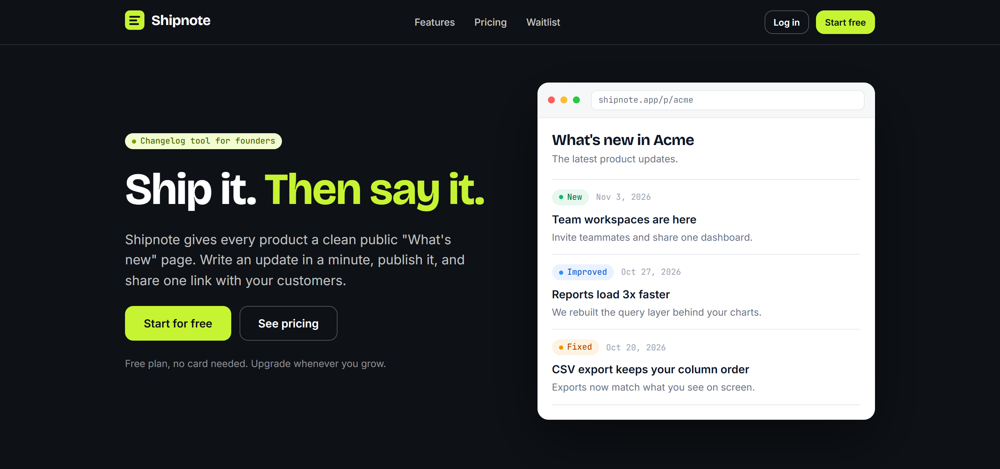
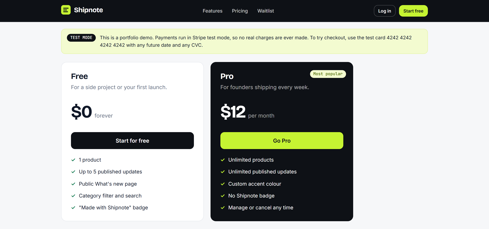

### Writing and publishing updates
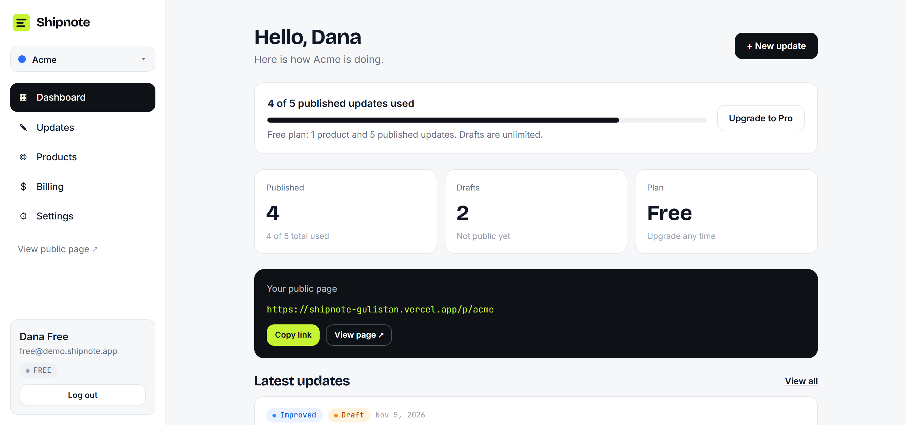
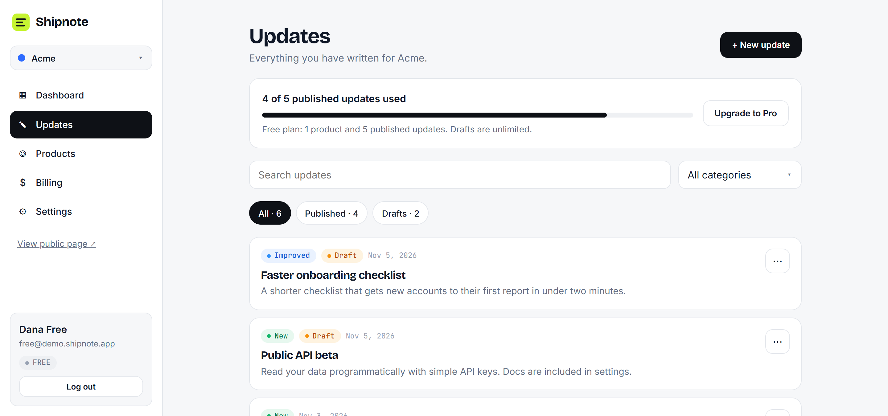
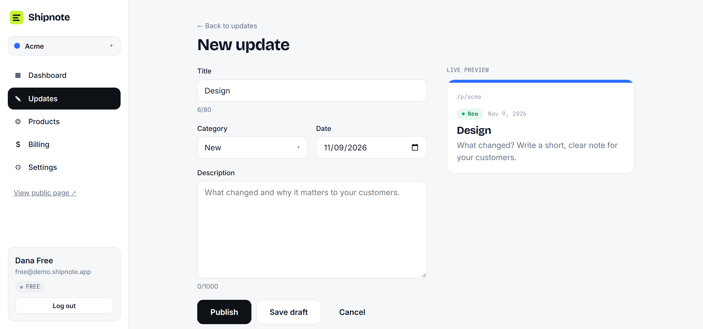

### Plan limit enforced by the server
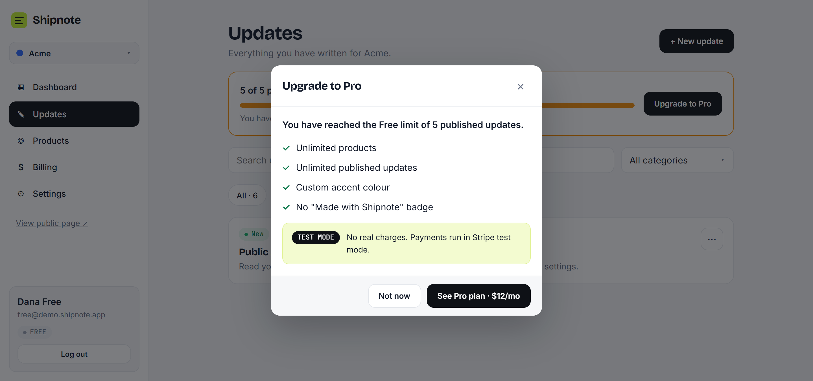

### Public page, billing and admin
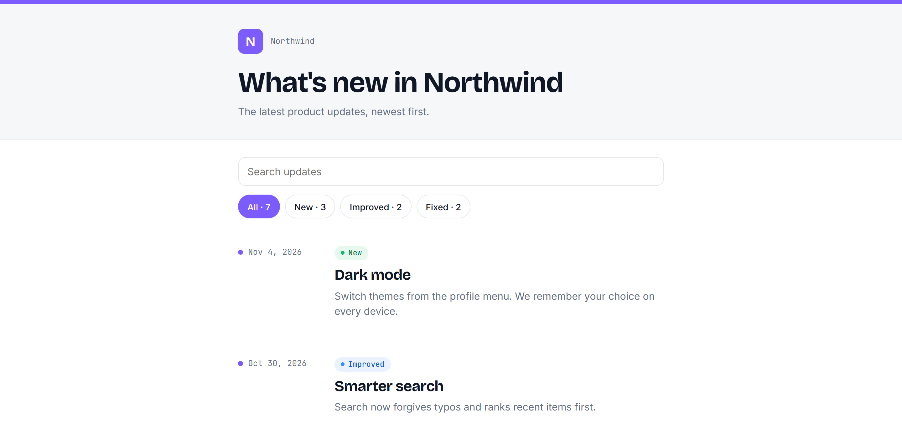
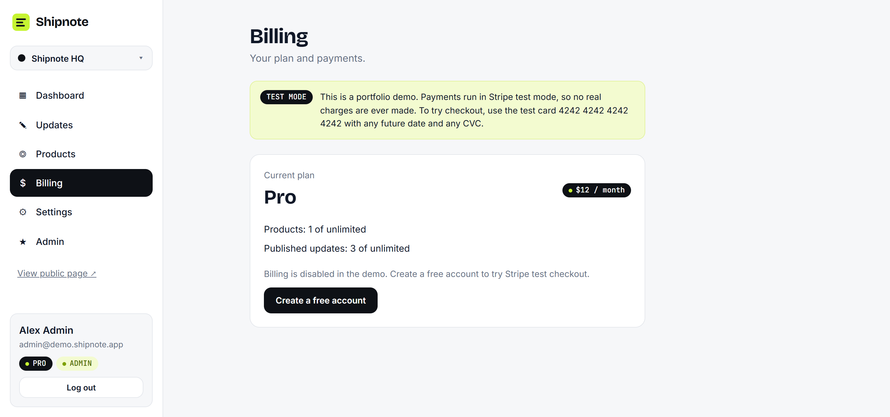
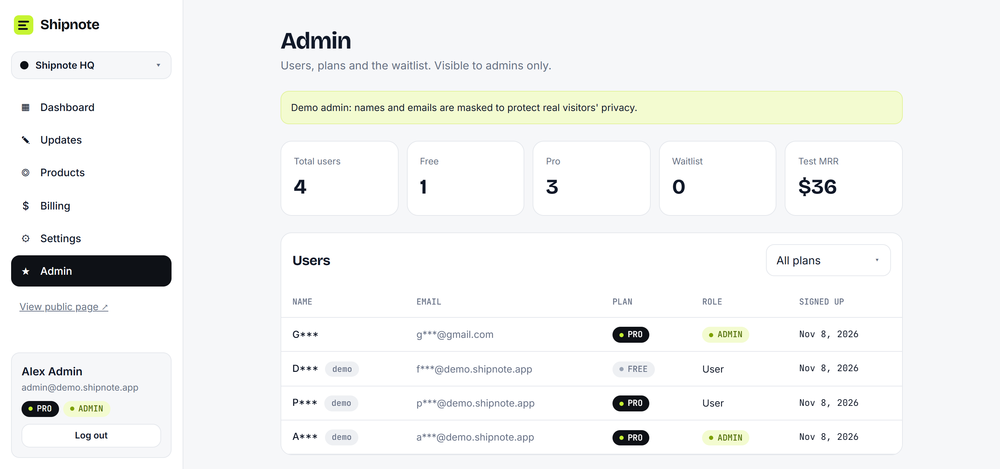

### On a phone
<p>
  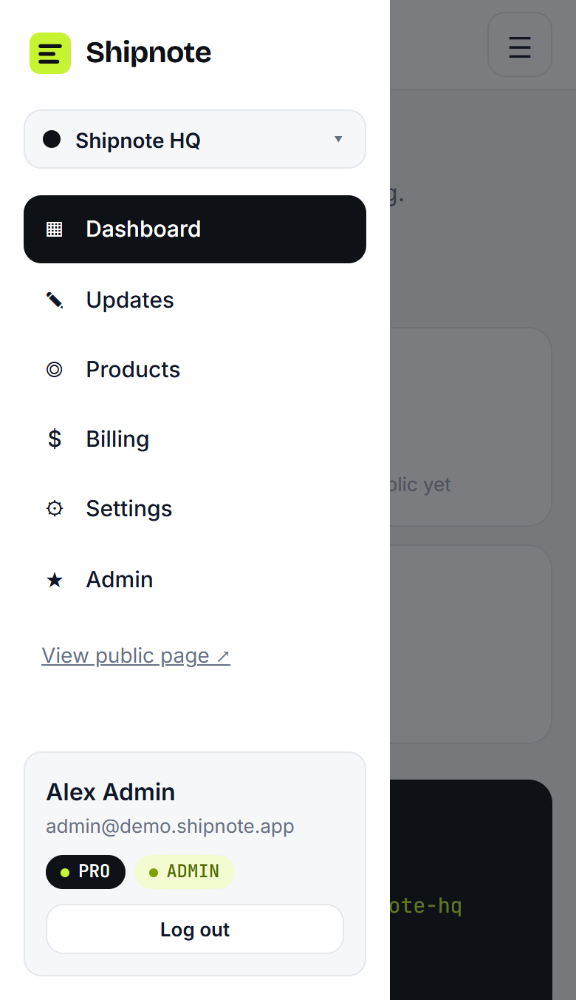
  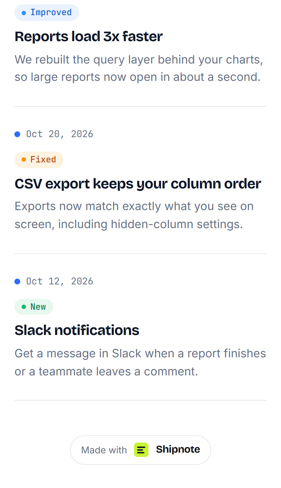
</p>

## How it is built

```
Browser ──► Vercel (one project, one domain)
            ├─ /          React + Vite app (static files)
            └─ /api/*     Express app running as a serverless function
                            │
                            ├─ Neon PostgreSQL (pooled connection)
                            └─ Stripe (Checkout, Customer Portal, Webhooks)
```

| Layer | Technology |
|---|---|
| Frontend | React, Vite, React Router, CSS written as camelCase style objects in each component |
| Backend | Node.js, Express, zod (input validation), bcrypt, JSON Web Tokens, Helmet |
| Database | PostgreSQL on Neon |
| Billing | Stripe Checkout, Customer Portal and webhooks (test mode) |
| Hosting | Vercel, deployed from this repository |

## Engineering decisions worth a look

1. **Plan limits are enforced on the server.** Creating a product or publishing an update runs inside a database transaction that locks the user's row first, so two quick clicks cannot both slip past the Free limit. Over the limit, the API answers `403 PLAN_LIMIT` and the interface shows the upgrade popup. See `backend/src/services/planLimits.js`.
2. **Only Stripe's webhook changes a plan.** The webhook verifies Stripe's signature on the raw request body, stores every event id so an event is processed only once, and re-reads the subscription from Stripe instead of trusting the event snapshot, which also protects against events arriving out of order. Cancelling keeps Pro until the paid period ends, then the plan drops back to Free and published updates stay online.
3. **All payment code is in one small module** (`backend/src/services/payments/stripeProvider.js`). The rest of the app talks to a tiny provider interface, so Stripe could be swapped for another provider. The server refuses to start with anything other than a `sk_test_` key.
4. **Login is a cookie, not a token in JavaScript.** An HttpOnly, Secure, SameSite=Lax cookie holds a signed token. The API and the website share one origin, passwords are hashed with bcrypt, login and waitlist are rate limited, state-changing requests are checked against the site's own origin, and every API response sends `Cache-Control: no-store`.
5. **Permissions live in one place.** Every product and update query checks ownership and answers 404 (not 403), so no one can discover another user's data by guessing ids. Admin routes check the role on the server.
6. **The public page leaks nothing.** It returns only published updates and the product's public details. The server decides whether to show the Free-plan badge.
7. **A demo that is safe to share.** Three shared demo accounts reset on every login, billing is disabled for them, and the demo admin sees masked names and emails so real visitors' data stays private.
8. **Interface details:** modals and dropdowns render through a portal so they are never clipped, layouts are checked on a 375px phone, and the admin table shows a visible hint when more columns scroll sideways.

## Run it locally

You need Node.js 20+, PostgreSQL, and (for billing) a free Stripe account in test mode plus the Stripe CLI.

```bash
git clone https://github.com/gulistankh/shipnote.git
cd shipnote

# 1. Create a PostgreSQL database named "shipnote" and run backend/db/schema.sql in it

# 2. Backend
cd backend
cp .env.example .env        # then fill in the values (see below)
npm install
npm run seed                # creates the three demo accounts
npm run dev                 # http://localhost:4000

# 3. Frontend (in a second terminal)
cd frontend
npm install
npm run dev                 # http://localhost:5173
```

Open `http://localhost:5173` (use `localhost`, not `127.0.0.1`). The Vite dev server forwards `/api` to the backend.

**Environment variables** (`backend/.env`):

| Name | What it is |
|---|---|
| `DATABASE_URL` | PostgreSQL connection string |
| `JWT_SECRET` | long random secret for signing the login cookie |
| `CLIENT_URL` | where the site runs, for example `http://localhost:5173` |
| `STRIPE_SECRET_KEY` | Stripe **test** secret key (`sk_test_...`) |
| `STRIPE_PRICE_PRO` | id of a recurring monthly price in Stripe |
| `STRIPE_WEBHOOK_SECRET` | webhook signing secret (`whsec_...`) |

**Testing webhooks locally:**

```bash
stripe listen --events checkout.session.completed,customer.subscription.created,customer.subscription.updated,customer.subscription.deleted --forward-to localhost:4000/api/stripe/webhook
```

## API overview

| Area | Endpoints |
|---|---|
| Auth | `POST /api/auth/signup`, `login`, `demo`, `logout`; `GET /api/me` |
| Onboarding and products | `POST /api/onboarding`, `GET /api/products/slug-check`, `POST /api/products`, `PATCH /api/products/:id` |
| Updates | `GET` and `POST /api/products/:id/updates`, `GET`, `PATCH` and `DELETE /api/updates/:id` |
| Public | `GET /api/public/:slug`, `POST /api/waitlist` |
| Billing | `POST /api/billing/checkout`, `POST /api/billing/portal`, `POST /api/stripe/webhook` |
| Admin | `GET /api/admin/overview` |

## Project structure

```
api/          Vercel entry point for the backend
backend/      Express API (routes, services, middleware, database schema)
frontend/     React app (pages, components, contexts, theme)
docs/         Screenshots used in this README
vercel.json   Build settings and URL rewrites
```

## Notes

- Hosted on free plans: the database sleeps when idle, so the first request after a pause can take a couple of seconds.
- Demo data resets whenever a demo account is used.
- This is a portfolio project. Nothing here is a real payment.

---

Designed and built by **Gulistan Kh**, UI/UX designer and full-stack developer.